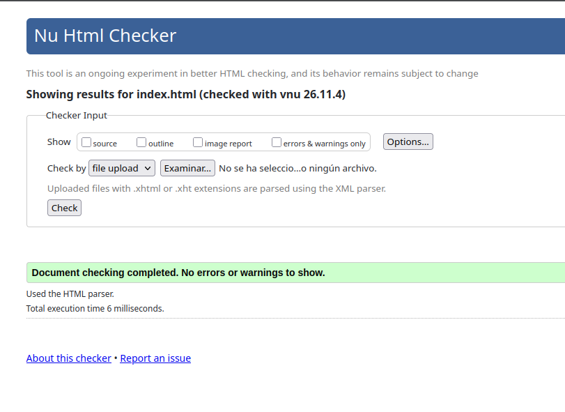
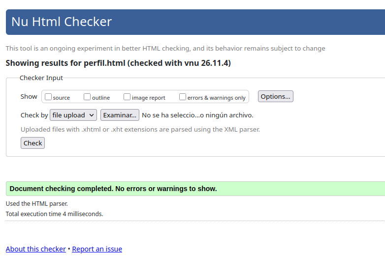
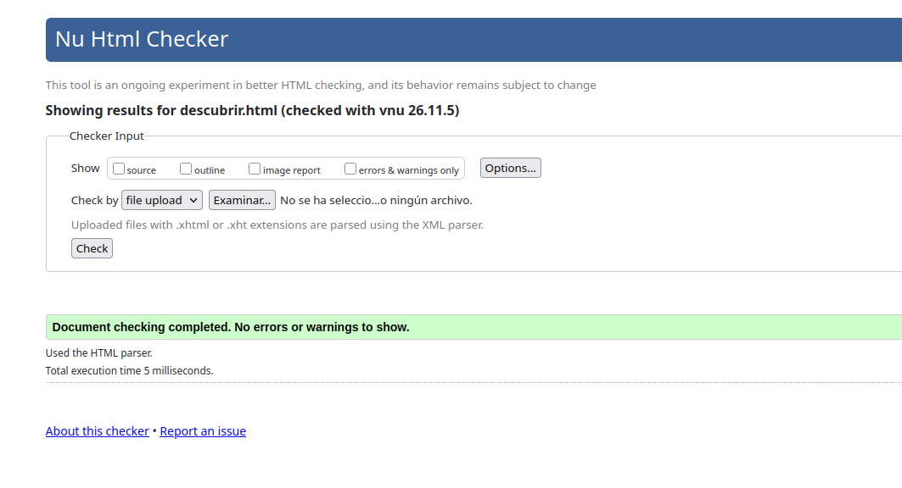

# 🎮 Nexus

**Juega, valora, comparte.** Biblioteca digital de videojuegos construida como práctica de maquetación con **Bootstrap 5** y personalización mediante **Sass**.

[](https://developer.mozilla.org/es/docs/Web/HTML)
[](https://getbootstrap.com/)
[](https://sass-lang.com/)
[](https://developer.mozilla.org/es/docs/Web/JavaScript)
[](https://nodejs.org/)

> Proyecto académico de desarrollo web · Sin frameworks de JavaScript, sin backend.

---

## ✨ Características

- **Cuatro páginas navegables**: inicio, biblioteca, descubrir y perfil.
- **Tema claro/oscuro** con persistencia en `localStorage` y detección de la preferencia del sistema (`prefers-color-scheme`).
- **Búsqueda en vivo** de juegos por título, manipulando el DOM sin frameworks.
- **Grid responsive** de tarjetas con portadas en formato 3:4.
- **Sass modular** organizado en parciales, mixins y variables de marca.
- **Accesibilidad**: enlace «saltar al contenido», `aria-*`, foco visible, `prefers-reduced-motion`, textos alternativos y carga diferida de imágenes.
- **Rendimiento**: imágenes con `width`/`height`, `loading="lazy"` y `decoding="async"`.
- **Enlaces relativos** para poder navegar también abriendo los archivos con `file://`.

## 📄 Páginas

| Página | Contenido |
| --- | --- |
| [`index.html`](./index.html) | Portada con hero y juegos destacados. |
| [`biblioteca.html`](./biblioteca.html) | Colección personal con buscador. |
| [`descubrir.html`](./descubrir.html) | Recomendaciones con buscador. |
| [`perfil.html`](./perfil.html) | Perfil de usuario y estadísticas. |

## 🛠️ Tecnologías

| Herramienta | Uso |
| --- | --- |
| HTML5 | Estructura semántica y accesible. |
| Bootstrap 5.3 | Grid, componentes y utilidades. |
| Sass (Dart Sass) | Variables, mixins y parciales compilados a CSS. |
| JavaScript | Cambio de tema y filtro de búsqueda. |
| Google Fonts | Tipografías *Roboto* y *Titillium Web*. |

## 🚀 Puesta en marcha

### Requisitos

- [Node.js](https://nodejs.org/) 18 o superior
- npm

### Instalación

```bash
git clone https://github.com/zereth070-art/nexus-bootstrap-practice.git
cd nexus-bootstrap-practice
npm install
```

### Desarrollo

```bash
npm run sass
```

Compila los estilos y se queda escuchando cambios: cada vez que guardes un `.scss` se regenera `scss/miestilo.css`.

Abre `index.html` en el navegador. Al usar enlaces relativos puedes hacerlo directamente con `file://`, aunque se recomienda una extensión como **Live Server** para recargar automáticamente.

### Compilación puntual

```bash
npm run sass:build
```

### Scripts disponibles

| Script | Descripción |
| --- | --- |
| `npm run sass` | Compila en modo *watch*. |
| `npm run sass:build` | Compila una vez, sin mapa de fuentes. |

## 📁 Estructura del proyecto

```text
nexus-bootstrap-practice/
├── index.html
├── biblioteca.html
├── descubrir.html
├── perfil.html
├── js/
│   └── main.js            # Tema claro/oscuro + búsqueda
├── scss/
│   ├── miestilo.scss      # Punto de entrada (importa Bootstrap y parciales)
│   ├── _variables.scss    # Paleta, tipografías y variables de Bootstrap
│   ├── _mixins.scss       # Mixins reutilizables (hover, foco, botones)
│   ├── _layout.scss       # Header, footer y skip-link
│   ├── _cards.scss        # Tarjetas de juego
│   ├── _botones.scss      # Botones y variantes
│   ├── _theme.scss        # Variables CSS para temas claro/oscuro
│   └── miestilo.css       # CSS compilado (no editar a mano)
├── images/                # Portadas, logo y favicon
├── package.json
└── package-lock.json
```

## 🎨 Personalización

La paleta de marca y las variables de Bootstrap se definen en `scss/_variables.scss`:

```scss
$primary:   #7B2CBF;
$secondary: #5A189A;
$dark:      #3C096C;
$body-bg:   #10002B;
$card-bg:   #240046;
```

Después de modificarlas, vuelve a compilar con `npm run sass` (o `npm run sass:build`). Los ajustes de cada tema viven en `scss/_theme.scss` bajo los selectores `[data-bs-theme="light"]` y `[data-bs-theme="dark"]`.

## ♿ Accesibilidad

- Enlace de salto al contenido principal.
- Etiquetas `aria-label`, `aria-current` y `aria-pressed` en la navegación y controles.
- Estados de foco visibles mediante el mixin `focus-ring`.
- Respeto por `prefers-reduced-motion` para desactivar animaciones.
- Imágenes decorativas con `alt=""` y portadas con texto alternativo descriptivo.

## 🧠 Aprendizajes

- Uso de **Sass modules** (`@use`) para organizar estilos y sobrescribir Bootstrap.
- Creación de **mixins** y convención **BEM** en componentes propios.
- Theming con variables CSS y el atributo `data-bs-theme` de Bootstrap 5.3.
- Manipulación del DOM y persistencia de preferencias con JavaScript *vanilla*.
- Buenas prácticas de accesibilidad y rendimiento en HTML.

## Comprobaciones del html







## 📝 Créditos

Proyecto académico de práctica. Las portadas y nombres de los videojuegos pertenecen a sus respectivos estudios y distribuidoras; se utilizan únicamente con fines educativos. Tipografías servidas por [Google Fonts](https://fonts.google.com/).
